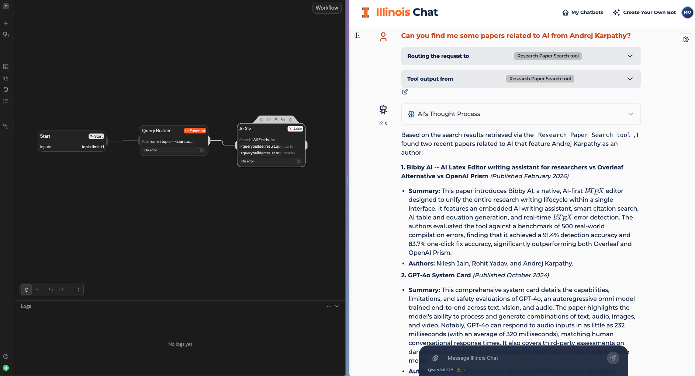
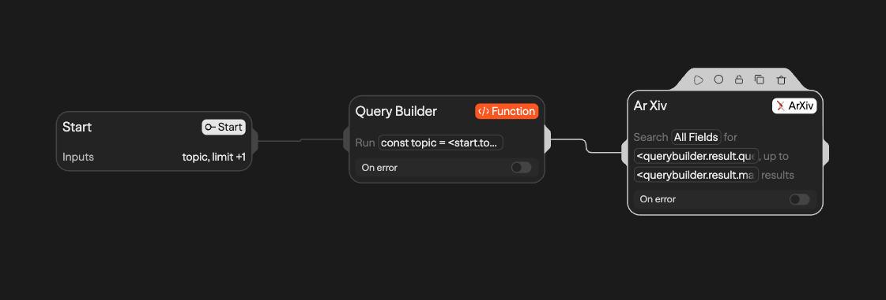
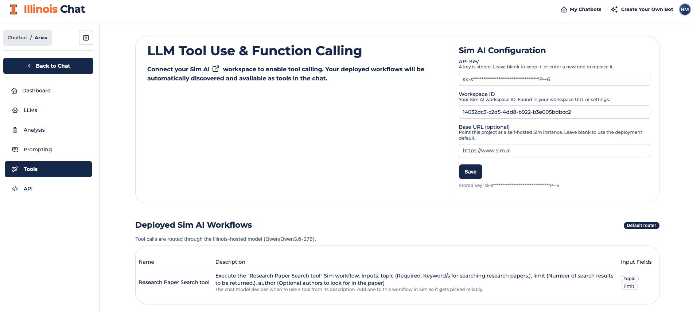
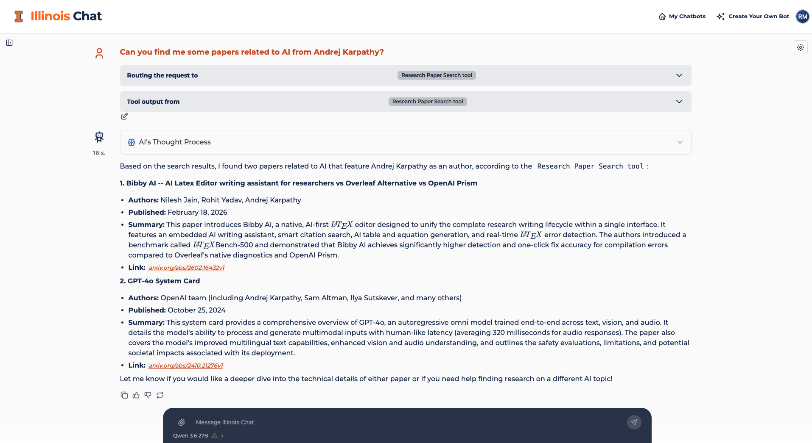

Illinois Chat v1.1 is here. Custom tools now run on [Sim AI](https://sim.ai), a visual workflow builder that replaces n8n. The whole interface has been rebuilt on a single component library. The documentation has a new home at [docs.chat.illinois.edu](https://docs.chat.illinois.edu/). And a long list of fixes makes chat, tools, and document ingest more reliable day to day.

<!-- more -->

<figure markdown="span">
  
</figure>

## At a glance

- **Tools are built in Sim.** Design a workflow visually, deploy it, and every connected chatbot can call it.
- **One consistent interface.** Every page uses the same buttons, dialogs, tables, and notifications.
- **Documentation has a new home.** Guides for building a chatbot, Sim tools, the API, and self-hosting live at [docs.chat.illinois.edu](https://docs.chat.illinois.edu/).
- **Chat folders belong to a project.** Each chatbot keeps its own folders, and deleting a folder no longer deletes the chats inside it.
- **Steadier ingest and chat.** A bad PDF fails on its own instead of stopping the ingest worker, and tool results keep both their data and their images.
- **Self-hosters have upgrade steps.** n8n is removed, Sim starts with the stack, and the Postgres volume mount has moved. See [Breaking changes](#breaking-changes-for-self-hosted-deployments).

## Build tools with Sim

Assistants in Illinois Chat can do more than answer from your documents. When a question needs it, the chatbot can call a tool: search arXiv, query a database, run a calculation, or reach an outside API, and then answer with the result. In v1.1 you build those tools in [Sim](https://sim.ai), an open-source canvas where you connect blocks into a workflow and deploy it with one click.

Illinois Chat hosts its own Sim instance at [sim.chat.illinois.edu](https://sim.chat.illinois.edu/). You sign in with the same Illinois account you use for chat, so there is no new password to manage.

<figure markdown="span">
  
  <figcaption>A workflow in Sim. The inputs on the Start block become the tool's parameters.</figcaption>
</figure>

### From workflow to chatbot in three steps

1. **Sign in to Sim.** Choose **Sign in with SSO** and log in with your Illinois account. New accounts wait for a platform admin's approval; [contact support](mailto:genaisupport@mx.uillinois.edu) if you are waiting.
2. **Build and deploy a workflow.** Give the workflow and each of its inputs a clear description. The model reads those descriptions to decide when to call your tool and what to pass it. Only **deployed** workflows become tools.
3. **Connect your project.** On your project's **Tools** page, paste a Sim API key and your workspace ID. Your deployed workflows appear right away, along with the inputs each one expects.

<figure markdown="span">
  
  <figcaption>The Tools page lists every deployed workflow in the connected Sim workspace.</figcaption>
</figure>

From then on, everyone chatting with that assistant can use the tools. Each user can switch individual tools on or off for a conversation from the **Tools** tab in chat settings.

<figure markdown="span">
  
  <figcaption>The chat shows which tool handled the request, and you can expand its raw output.</figcaption>
</figure>

A few details worth knowing:

- **Keys stay private.** Sim API keys are encrypted on the server, and the page only ever shows them masked.
- **Building tools together is easy.** Invite colleagues to your Sim workspace. Anything they deploy shows up on every project connected to that workspace, with no extra setup in Illinois Chat.
- **Routing works out of the box.** The Tools page shows which model decides when to call a tool: your project's own OpenAI-compatible provider, or the Illinois-hosted default.
- **Blocks come from a curated list.** The hosted Sim offers its core workflow blocks plus about 40 integrations that you sign in to with your own key, such as Tavily, ArXiv, GitHub, and PostgreSQL. Integrations that need a **Connect** button (Google Drive, Slack, Notion, and others) are not available yet. The [Sim user guide](../../building/tools/sim-user-guide.md#which-sim-blocks-you-can-use) has the full list.

!!! warning "n8n has been retired"
    We have shut down our n8n service, so tools built there no longer work and can't be recovered. Recreate them as Sim workflows. [Build a Tool in Sim](../../building/tools/build-a-tool.md) walks through a complete example from start to finish.

New to Sim? Start with the [Sim user guide](../../building/tools/sim-user-guide.md). If you run your own deployment, see the [Sim operator guide](../../self-hosting/sim.md).

## A rebuilt, consistent interface

Illinois Chat had grown on top of three UI toolkits, so a dialog on one page could look and behave differently from a dialog on the next. In v1.1, every screen shares one set of components. Buttons, menus, tables, dialogs, and notifications now look and behave the same everywhere, in both light and dark mode.

<!--
IMAGE: a before/after of one screen that changed visibly, such as the project dashboard
or the chatbot hub. Same project, same viewport width, v1.0 on the left and v1.1 on the
right. Material's tabbed content also works if side by side is too cramped:

=== "v1.1"
    
=== "v1.0"
    
-->

The redesign covers the navigation bar, the chatbot hub, the project dashboard, notifications, and the project and Tools pages. Along the way:

- The account menu works fully from the keyboard.
- Notifications are consistent, appear once, and include a close button.
- The model picker no longer gets cut off on small screens.
- Toggle switches and dropdowns show their real state. For example, disabled models on the LLM admin page no longer look enabled.

<!--
IMAGE (optional): a phone-width screenshot of chat with the model picker open, to show
the small-screen fix. A narrow screenshot next to the paragraph works well:

{ width="320" align=right }
-->

Under the hood, the frontend now runs on React 19, Next.js 16, Tailwind CSS 4, and [shadcn/ui](https://ui.shadcn.com/) built on Base UI. Mantine and DaisyUI have been removed.

## Better chat organization

Chat folders now belong to a project. Each chatbot keeps its own folders, and you no longer see folders from one course while chatting in another. Deleting a folder now keeps its conversations: they move back to your main chat list instead of disappearing.

<!--
IMAGE (optional): the chat sidebar with a few project-specific folders, light or dark mode.

<figure markdown="span">
  
</figure>
-->

## Fixes

- **Citations:** the citation toggle now stays in sync with the system prompt.
- **Tool results:** a tool's structured data is kept when its result also includes images.
- **Document groups:** deleting a document now updates the counts for its document groups.
- **Countries-of-concern notice:** chat input, file upload, and regenerate stay locked until you dismiss the notice.
- **Ingest:** a large or malformed PDF now fails on its own instead of taking down the ingest worker.
- **External connections:** changes to an external vector store connection take effect on the next request.
- **In-browser models:** chats with WebLLM models wait for the model to finish loading before they generate.

## New documentation

Guides now live at [docs.chat.illinois.edu](https://docs.chat.illinois.edu/). They are versioned with the code, so a page matches the release you are running, and this blog is where release notes are published.

- **[Quickstart](../../getting-started/quickstart.md)** takes you from sign-in to a working, cited assistant.
- **[Building a chatbot](../../building/index.md)** covers documents, prompts, models, and sharing.
- **[Sim user guide](../../building/tools/sim-user-guide.md)** covers signing in, connecting a workspace, and which blocks you can use.
- **[Self-hosting](../../self-hosting/index.md)** covers the Docker Compose stack, configuration, and upgrades.
- **[API reference](../../api/index.md)** covers the chat and retrieval endpoints.

## For developers

- The [Chat API](../../api/chat.md) accepts a `top_n` parameter that caps how many document contexts are retrieved (default `100`).
- Local development compiles about 2.6 times faster from a cold start now that the dev server uses Turbopack.
- The frontend Docker image runs Node 22. Contributors need Node 20.19 or later, or 22.12 or later.

## Breaking changes for self-hosted deployments

!!! info "On the hosted site?"
    If you use [chat.illinois.edu](https://chat.illinois.edu), there's nothing to do here. Skip ahead to [Thank you](#thank-you).

If you run the full stack yourself, review these changes before you upgrade.

**Tools**

- **n8n is removed.** The integration is gone from the code and the database schema. Recreate existing tools in Sim.
- **Sim starts with the stack.** `start-all.sh` and `start-dev.sh` bring Sim up alongside the app. Pass `--no-sim` to `stop-all.sh` or `stop-dev.sh` to leave Sim running while you stop everything else.
- **`SIM_APPROVAL_ADMIN_EMAIL` is required.** The Sim stack will not start without it.
- **`SIM_SSO_DOMAIN` takes one domain.** A comma-separated list blocks every sign-in.
- **`SIM_*` secrets are generated on first start.** No defaults are published, including the Sim Postgres password and the OIDC client secret.
- **`ENCRYPTION_MASTER_KEY` now also encrypts per-project Sim API keys.** It is the same key used for external connections.

**Data and infrastructure**

- **The Postgres volume mount has moved** to `/var/lib/postgresql/data`. Existing `postgres-illinois-chat` volumes will not start as they are. Either reset them with `--wipe_data` / `--clean`, or follow the copy steps on [Upgrading](../../self-hosting/upgrading.md) to keep your data.
- **Object storage now uses [Silo](https://github.com/pgsty/silo)**, a maintained fork of MinIO, because MinIO no longer publishes community images. It uses the same credentials and bucket, and the start scripts pull it automatically.
- **Database migrations 0016–0018 must run.** They encrypt `projects.sim_api_key` and link folders and conversations to projects. Both start scripts apply them on boot.

## Upgrade

Fetch the new tag and start the stack. If your database dates from v1.0, read the Postgres mount note above **before** you boot.

```bash
git fetch origin --tags
git checkout v1.1
bash infra/scripts/start-all.sh
```

Then:

1. Open Sim and approve your tool builders under **Settings → Admin**.
2. On each project's **Tools** page, connect a Sim API key and workspace ID.

## Thank you

Thanks to everyone who reported bugs, tested early builds, and contributed code for this release. Questions or feedback? Email [genaisupport@mx.uillinois.edu](mailto:genaisupport@mx.uillinois.edu) or [open an issue on GitHub](https://github.com/Center-for-AI-Innovation/Illinois-Chat/issues).

Full changelog: [v1.0...v1.1](https://github.com/Center-for-AI-Innovation/Illinois-Chat/compare/v1.0...v1.1).
